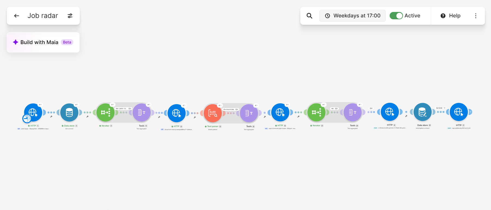
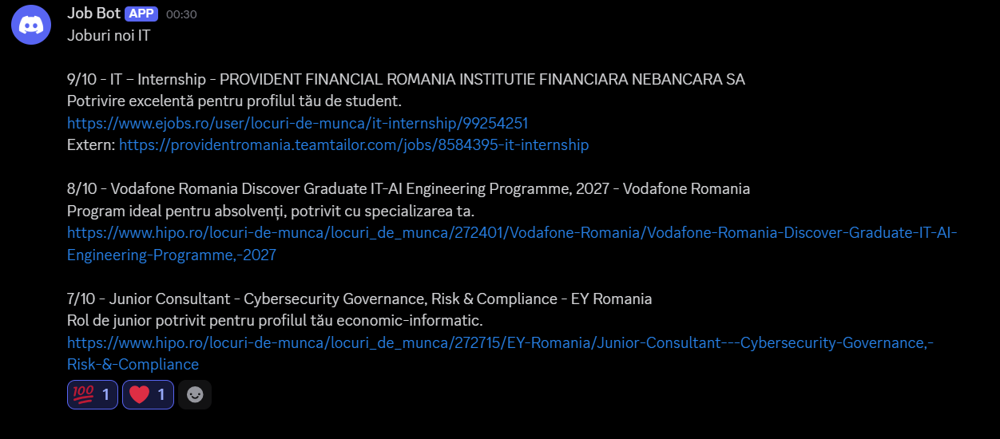

# Job Radar

A small personal automation that checks three job boards once a day, scores the new postings with Gemini against my profile and sends me a short digest on Discord.

I built it to learn and to get rid of a repetitive, time-consuming task: as a 3rd-year student looking for IT internships and junior roles, I was opening the same sites every day and scrolling through the same listings. Now I get one message at 17:00 with only the jobs worth looking at. It is for personal use only, runs once per working day, and reads nothing but titles and links.

## How it works

One Make scenario runs every working day at 17:00 and goes through four steps:

1. **Collect.** It pulls the 100 newest IT postings from the eJobs API, the first page of hipo.ro results (plain HTML, parsed with one regex) and the latest remote jobs from the Jobicy API.
2. **Keep only what is new and plausible.** eJobs and Jobicy postings are kept if they were published after the previous run; for eJobs the level IDs and location are also checked, so only junior or no-experience roles in Bucharest or remote go through. hipo postings are kept if their ID has not been sent before (hipo shows the same date on every listing, so dates are useless there).
3. **Score.** Everything that survived is written as one line per job and sent in a single request to Gemini, together with my profile and a scoring rubric. The model answers either NONE or a ready-made Discord message with the jobs that scored 7 or more.
4. **Deliver and remember.** The message goes to a Discord channel through a webhook, and a small data store is updated with the time of the run and the hipo IDs already sent, so the next run starts from there.

Everything runs in [Make](https://www.make.com) on the free plan, as a single linear scenario (~13 operations per run, ~4 when nothing is new).

### Why once a day, at 17:00

I started with three runs a day. It turned out to be more noise than signal: a job posted at 10:00 is still there at 17:00, and nobody closes an internship application within a few hours. One run at the end of the working day catches everything posted that day in a single digest I can read in a minute, costs a third of the operations on the free plan (the eJobs page of 100 newest IT jobs covers about four days, so nothing slips through the gap), and sends one message per day instead of three half-empty ones.

### Sources

| Source | Access | What it gives | How "new" is detected |
|---|---|---|---|
| eJobs | Undocumented JSON API, no key | title, company, level IDs, contract IDs, locations, date | `creationDate > lastRun` |
| hipo.ro | Server-rendered HTML, parsed with one regex | title, company, link | ID remembered in the data store (hipo shows the same date for every listing, so dates are useless). A title regex (intern/junior/trainee/...) also drops obvious non-matches before Gemini |
| Jobicy | Public API, documented, no key | title, company, level, type, date | `pubDate > lastRun` |

The listing-level metadata is all Gemini sees; descriptions are not fetched.

### Scoring

Each run sends one request to `gemini-3.5-flash-lite` with my profile, a 0 to 10 rubric, hard exclusions (senior/lead/manager, 2+ years, sales/call-center, on-site outside Bucharest, mandatory languages other than RO/EN), a legend for the source codes and the list of jobs, one per line. The model answers either `NONE` or a ready-to-send Discord message (max 8 jobs, under 1900 characters). For sources that don't expose seniority, a job can only score 7+ if the title itself says intern/junior/trainee. I'd rather miss a borderline job than get spam.

The full prompt is in [`prompt-gemini.txt`](prompt-gemini.txt). A typical message:

### State

A Make data store holds one record with `lastRun` (timestamp of the previous run) and `hipoSeen` (a comma-delimited list of hipo IDs already sent, e.g. `,272715,272401,`). The list is updated from the aggregated text with three nested `replace()` calls.

## Things that broke and how I fixed them

- **No documentation anywhere.** The eJobs API was found by probing `api.ejobs.ro`; its error messages (`PageSize cannot be 0`, `filters ... JobsFiltersRequest`) revealed the parameter names. hipo's RSS feeds are dead, so I parse the HTML with a named-group regex (`hipo-regex.txt`).
- **"Enter valid JSON"** in the Gemini request body: quotes and newlines inside job titles broke the hand-built JSON. Fixed by letting Make build the body from a data structure.
- **Timeouts / 503** from a heavier Gemini model: switched to the lite model, `thinkingLevel: low`, 120 s timeout.
- **Empty or truncated Discord messages:** Gemini sometimes returns the text split across several `parts`. Fixed with `join(map(parts; "text"); "")`.
- **Gemini always answered NONE:** a mapping referenced a module ID that no longer existed and was sent as literal text. Lesson: Make module numbers are IDs, not positions.
- **Make editor quirks:** empty function arguments are not empty strings (use `emptystring`), keywords like `newline` must be inserted as pills, and regex arguments must not be quoted.

## Setup

1. Import `blueprint.json` into Make.
2. Create a data store `jobradar-state` with fields `lastRun` (Date) and `hipoSeen` (Text); add one record with key `state`, `hipoSeen` = `,`.
3. Add a Gemini API key from Google AI Studio as an API-key connection (header `x-goog-api-key`).
4. Put your Discord webhook URL in the last module.
5. Adjust the candidate profile in the prompt, run once, then schedule.

Secrets are not in the repository.

## What I'd add next

- Greenhouse / Lever boards of specific companies (both have public JSON APIs).
- bestjobs.eu. I looked at it, but it blocks automated traffic, so I left it out.
- A weekly summary of everything that scored 5 or 6, to catch what the strict filter drops.

## Stack

Make (HTTP, Iterator, Text aggregator, Text parser, Data store), Gemini API, Discord webhooks, regex
